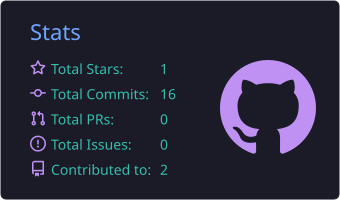

    <h1>Тентимишев Назар</h1>
    <h3>Senior Data Engineer</h3>
    
Ташкент, Узбекистан · Fintech & Banking · DWH, ETL, Data Governance

## 📊 GitHub-статистика

    
    

    

## 🛠️ Навыки и технологии

- **Языки программирования**: Python, SQL
- **Оркестрация и ETL**: Apache Airflow, dbt, Apache NiFi, StreamSets, Kafka, Talend
- **Базы данных**: PostgreSQL (DWH, многослойная архитектура L0/L1/L2), ClickHouse, Oracle, MS SQL Server
- **Облачные платформы**: AWS (Redshift, S3, Lambda), Google Cloud Platform (BigQuery, Cloud Storage)
- **BI и каталог данных**: Apache Superset, Tableau, Power BI, OpenMetadata, NocoDB
- **Контроль версий**: Git, GitHub, GitLab

## 🌱 Чем я сейчас занимаюсь

Работаю Senior Data Engineer в JSC Octobank: разрабатываю и оптимизирую ETL-процессы, строю DWH и масштабируемые аналитические решения.

## 🎯 Цели

- Углубить навыки работы с Apache Kafka и потоковой обработкой данных
- Изучить Data Science и машинное обучение
- Участвовать в open-source проектах, связанных с данными и аналитикой

## 📫 Контактная информация

    
    <a href="https://www.instagram.com/14ll04ll01/">
        <img src="https://w7.pngwing.com/pngs/789/603/png
